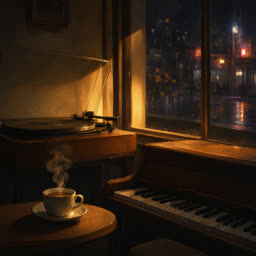
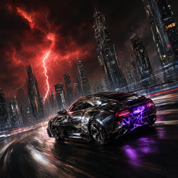
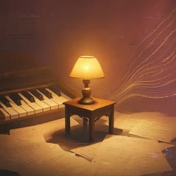

# YuE2-3B ROCm Accelerator (AMD Radeon PRO V620 / RDNA2 `gfx1030`)

Custom Wave32 HIP C++ kernels, FP16 NAR flow-matching runtime, Suno-inspired Studio Web UI, REST API, and MCP server for [`m-a-p/YuE2-3B`](https://huggingface.co/m-a-p/YuE2-3B) + [`m-a-p/YuE2-Vae`](https://huggingface.co/m-a-p/YuE2-Vae) on AMD ROCm GPUs.

Generates a full **120-second 48 kHz stereo song in 25.4 seconds** (**25.1× faster** than stock PyTorch BF16, **4.72× faster than realtime**) on a single AMD Radeon PRO V620 (32 GB).

---

## Audio Samples (Generated on V620)

> **[▶ Open the Interactive Web Audio Player](https://franktheglock.github.io/yue2-rocm-v620/)** — stream all 6 full-length 48 kHz stereo tracks directly in your browser (no download required).

All tracks below were generated end-to-end on a single AMD Radeon PRO V620 (`ar_quant="w4"`, FP16 NAR, 8-step Midpoint ODE, 48 kHz stereo):

| Cover | Track & Genre | Mode | Length | Render Time | Play Online |
|:---:|---|---|---:|---:|:---:|
| — | **Electric in the Rain**<br>Upbeat synth-pop, energetic female vocal, analog synths, 120 BPM | `cot="off"` · 8-mid | `2:00` | **25.4s** (4.72× RT) | [▶ Play](https://franktheglock.github.io/yue2-rocm-v620/#electric-in-the-rain) |
|  | **Velvet Coffee at 2 AM**<br>Late-night lo-fi neo-soul jazz, dusty Rhodes, upright bass, brushed snare, 86 BPM | `cot="full"` · 8-mid | `2:00` | **39.1s** (3.07× RT) | [▶ Play](https://franktheglock.github.io/yue2-rocm-v620/#velvet-coffee) |
|  | **Cedar & Lantern Light**<br>Warm acoustic indie folk ballad, male vocal, fingerpicked guitar, cello, 94 BPM | `cot="full"` · 8-mid | `2:00` | **39.5s** (3.04× RT) | [▶ Play](https://franktheglock.github.io/yue2-rocm-v620/#cedar-lantern) |
|  | **Overclocked Skyline**<br>Cyber metal / hard rock, 7-string distorted guitars, double-kick drums, 145 BPM | `cot="full"` · 8-mid | `2:00` | **54.7s** (2.19× RT) | [▶ Play](https://franktheglock.github.io/yue2-rocm-v620/#overclocked-skyline) |
|  | **Training AGI (K-pop Ver.)**<br>Upbeat K-pop dance-pop, bright female vocal, sparkling synths, 124 BPM | `cot="full"` · 8-mid | `2:47` | **54.3s** (3.07× RT) | [▶ Play](https://franktheglock.github.io/yue2-rocm-v620/#training-agi-kpop) |
|  | **Another Me**<br>Dreamy indie electronic pop, warm analog synths, piano, airy female vocal, 98 BPM | `cot="full"` · 8-mid | `3:57` | **80.6s** (2.94× RT) | [▶ Play](https://franktheglock.github.io/yue2-rocm-v620/#another-me) |

---

## Benchmarks (AMD Radeon PRO V620 · `gfx1030` · 120s 48 kHz Stereo Song)

| Configuration | AR (3,000 tok) | NAR (ODE) | VAE (FP32) | **Total E2E** | **Speedup** |
|---|---:|---:|---:|---:|---:|
| **Stock YuE2-3B BF16** (PyTorch Eager + Math SDPA, 32-mid) | 454.0s (6.6 tok/s) | 180.6s (64 NFE) | 1.98s* | **636.6s** | 1.0× |
| **V620 Optimized** (`cot="off"`, 32-step Midpoint, 64 NFE) | 13.82s (219.1 tok/s) | 40.21s (64 NFE) | 1.42s | **55.44s** | **11.5×** |
| **V620 Optimized** (`cot="full"`, 1,587 ABC + 3,000 Sem, 5-mid) | 22.73s (205.8 tok/s) | 8.04s (10 NFE) | 1.41s | **32.19s** | **19.8×** |
| **V620 Optimized** (`cot="off"`, 12-step Midpoint, 24 NFE) | 13.82s (219.1 tok/s) | 15.02s (24 NFE) | 1.42s | **30.25s** | **21.0×** |
| **V620 Optimized** (`cot="off"`, **8-step Midpoint, 16 NFE**) | **13.82s (219.1 tok/s)** | **10.18s (16 NFE)** | **1.41s** | **25.41s** | **25.1×** |

*\*Stock VAE on `gfx1030` hits an MIOpen 1D conv workspace bug (>360s hang) unless `torch.backends.cudnn.enabled = False`.*

### Numerical Accuracy vs Stock BF16 / 32-Step Midpoint Reference
| Stage & Comparison | Cosine Sim | SNR (dB) | Notes |
|---|---:|---:|---|
| AR Logits: **W8A16** vs BF16 | `0.99993` | `38.06 dB` | Top-1 Match |
| AR Logits: **W4A16 (g=128)** vs BF16 | `0.99679` | `21.87 dB` | Top-1 Match, 100% Top-5 overlap |
| NAR Precision: **FP16 (32-mid)** vs BF16 (32-mid) | `0.99993` | `38.33 dB` | Virtually identical latents |
| NAR ODE: **12-step Midpoint** vs 32-step Midpoint | `0.99908` | `27.34 dB` | Audio Cosine `0.9970` |
| NAR ODE: **8-step Midpoint (25.4s)** vs 32-step Midpoint | `0.99550` | `20.47 dB` | Audio Cosine `0.9857` |
| VAE Audio: **Fused HIP `SnakeBeta`** vs PyTorch FP32 | `0.999999999999` | `102.68 dB` | `max_abs = 1.79e-5` |

---

## Why Stock PyTorch Is Slow on RDNA2 (`gfx1030`) & What We Built

1. **Emulated BF16 → Native FP16 + Custom W4A16/W8A16 HIP GEMV (`v620_kernels.hip`):** On `gfx1030`, BF16 GEMV runs at 29.9 GB/s vs FP16 at 262 GB/s. Our 8-warp LDS-fused RMSNorm + 128-bit `uint4` W4A16 GEMV & fused SwiGLU kernels + sliced `lm_head` (32,769 allowed semantic tokens instead of 184,704) push AR decode from **6.6 → 219.1 tok/s** (**33.1×**).
2. **Missing FlashAttention on `gfx1030` → Infinity-Cache rocBLAS + Wave32 HIP Online-Softmax:** PyTorch SDPA falls back to Math SDPA (`35.84 ms / 4.80 TFLOPS`). Our tiled split-KV attention (`BN=512` tuned for RDNA2's 128 MB Infinity Cache, zero `torch.cat` copies) hits **10.38 ms / 16.59 TFLOPS** (**3.45×** faster).
3. **GQA-Paired Split-KV FlashDecode:** Processes both Q heads per KV head in a single block with 64-bit coalesced loads, hitting **429.1 GB/s** (84% of V620 HBM peak, `3e-5` error).
4. **Oobleck VAE Acceleration:** Keeps both YuE2-3B and YuE2-Vae resident on 32 GB VRAM (~9.9 GB total), fuses `weight_norm`, replaces 6-kernel `SnakeBeta` with a single fused HIP kernel (**5.88×** faster), and bypasses MIOpen 1D conv workspace bugs (`1.41s` for 120s FP32 audio).

---

## Quick Start

### 1. Prerequisites
- AMD ROCm GPU (tested on Radeon PRO V620 / `gfx1030`, 24 GB+ VRAM recommended)
- [`uv`](https://docs.astral.sh/uv/) (installs Python 3.12 for you), `ffmpeg`, and `hipcc` from the ROCm 7.x HIP SDK (for the custom kernels)
- About 30 GB of disk for the two environments (ROCm PyTorch is ~14 GB each)

```bash
./setup.sh            # builds .venv + .venv-flamingo, compiles kernels, then checks everything
./setup.sh check      # re-verify any time
```
`setup.sh` installs ROCm PyTorch (`torch 2.13.0+rocm7.1`) from the PyTorch ROCm index, the pinned deps in `requirements/`, and the `yue2_infer` wheel from [`m-a-p/YuE2-3B`](https://huggingface.co/m-a-p/YuE2-3B) (with `--no-deps`, so its CUDA torch pin can't replace the ROCm build). Run one step with `./setup.sh core|flamingo|kernels`; override versions with `TORCH_INDEX_URL`, `TORCH_VERSION`, `PYTHON_VERSION`, `HIPCC`, or `GPU_ARCH` (see the header of `setup.sh`).

- **`.venv`**: YuE2 engine, Studio web server, MCP server, SheetSage2.
- **`.venv-flamingo`** (optional): Music Flamingo + Parakeet for *From Audio*. They need transformers 5.x, which conflicts with YuE2's pinned 4.57.6.

### 2. CLI Generation
```bash
python run_yue2.py --ar-quant w4 --cot off --ode-steps 8 --ode-method midpoint --max-seconds 120
# Full symbolic ABC score planning:
python run_yue2.py --ar-quant w4 --cot full --ode-steps 5 --ode-method midpoint --max-seconds 120
```

### 3. Studio Web UI & REST API
```bash
python web_server.py
# Open http://localhost:8789/  (Swagger API docs at /docs)
```

#### Optional models (Instrumental mode & From Audio)
These features need extra weights. The Studio shows a **Download** button wherever one is missing (and lists them all under *Settings → Local Models*), or fetch them yourself into the repo root:

| Feature | Folder | Hugging Face repo | Size | License |
|---|---|---|---|---|
| Instrumental mode | `YuE2-Inst-LoRA/` | [`Mothersuperior/YuE2-instrumental-cot-full-loras`](https://huggingface.co/Mothersuperior/YuE2-instrumental-cot-full-loras) (bf16 file only) | 0.14 GB | CC BY-NC 4.0 |
| Derive Style Prompt | `music-flamingo-2601-hf/` | [`nvidia/music-flamingo-2601-hf`](https://huggingface.co/nvidia/music-flamingo-2601-hf) | 16.5 GB | NVIDIA OneWay Noncommercial |
| Cover score (ABC + structure) | `SheetSage2/` + `MERT-v2-FullSong/` | [`m-a-p/SheetSage2`](https://huggingface.co/m-a-p/SheetSage2) + [`m-a-p/MERT-v2-FullSong`](https://huggingface.co/m-a-p/MERT-v2-FullSong) | 2.8 GB | CC BY-NC 4.0 |
| Lyrics extraction | `parakeet-tdt-0.6b-v3/` | [`nvidia/parakeet-tdt-0.6b-v3`](https://huggingface.co/nvidia/parakeet-tdt-0.6b-v3) (skip `*.nemo`, `*.gguf`) | 2.5 GB | CC BY 4.0 |

Set `YUE2_MODELS_DIR=/big/disk/models` to have in-app downloads land there (symlinked into the repo). Music Flamingo and Parakeet also need the separate `.venv-flamingo` environment; build it with `./setup.sh flamingo`.
Optional AI song auto-naming & album cover art (runs in parallel with audio generation; supports **OpenAI-compatible**, **OpenRouter**, **Anthropic**, and **Ollama** LLMs + **SDAPI/A1111/Forge**, **OpenAI**, **OpenRouter**, and **fal.ai** image gen):
```bash
# Example 1: Local llama.cpp + SDAPI / Qwen-Image
export YUE2_COVER_LLM_PROVIDER="openai"          # openai | openrouter | anthropic | ollama
export YUE2_COVER_LLM_URL="http://192.168.1.142:18081"
export YUE2_COVER_LLM_MODEL="maple-cpu"
export YUE2_COVER_IMG_PROVIDER="sdapi"           # sdapi | openai | openrouter | fal
export YUE2_COVER_IMG_URL="http://192.168.1.142:8080"
export YUE2_COVER_IMG_MODEL="qwen-image-2.1-turbo"

# Example 2: OpenRouter (LLM + Image Gen)
# export YUE2_COVER_LLM_PROVIDER="openrouter"
# export YUE2_COVER_LLM_MODEL="google/gemini-2.5-flash"
# export YUE2_COVER_LLM_API_KEY="sk-or-..."
# export YUE2_COVER_IMG_PROVIDER="openrouter"
# export YUE2_COVER_IMG_MODEL="google/gemini-2.5-flash-image-preview"
# export YUE2_COVER_IMG_API_KEY="sk-or-..."

# Example 3: fal.ai Image Gen (Flux)
# export YUE2_COVER_IMG_PROVIDER="fal"
# export YUE2_COVER_IMG_MODEL="fal-ai/flux/schnell"
# export YUE2_COVER_IMG_API_KEY="fal_..."

python web_server.py
```

### 4. MCP Server (stdio or LAN Streamable HTTP)
```bash
# Stdio (for Claude Code / Cursor / Antigravity):
python mcp_server.py

# Streamable HTTP on LAN:
YUE2_API_URL=http://127.0.0.1:8789 python mcp_server.py --http --host 0.0.0.0 --port 8790
```
Songs triggered via MCP stream live into the open Web UI over SSE (`/api/events`).

---

## License
- Code in this repository: MIT.
- Model weights (`m-a-p/YuE2-3B` and `m-a-p/YuE2-Vae`): [CC BY-NC 4.0](https://huggingface.co/m-a-p/YuE2-3B/blob/main/LICENSE) (downloaded separately from Hugging Face).

---

## Sharing the GPU with a model router (llama.cpp router / Hermes Console)

If another service on the same machine loads LLMs onto the same GPU, YuE2 Studio can free that VRAM automatically. Before every generation it queries the router (default `http://127.0.0.1:8084`) and unloads every loaded model. The router reloads models on demand afterwards.

- Configure it in **Settings → Shared GPU · Model Router**, or via `YUE2_UNLOAD_URL` / `YUE2_UNLOAD_ENABLED=0`.
- Manual trigger: `POST /api/settings/unload-now`.
- **Reverse direction:** while the studio is idle and the router has a model loading/loaded, YuE2 releases its own ~9.9 GB of VRAM (checked every second). It reloads in ~3 s when the next song is requested. Toggle with **Settings** or `YUE2_YIELD_ENABLED=0`.
